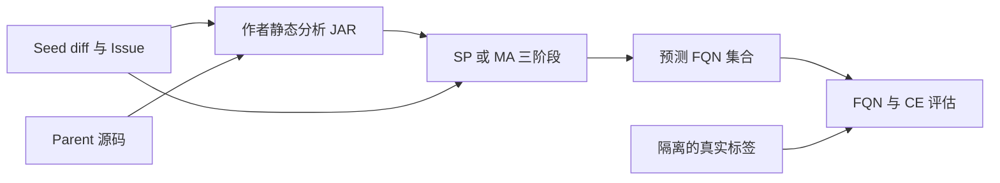

# KatlA 单仓库 CIA 复现

_2026-11-16；目录按用户指定命名为 KatlA，论文方法拼写为 katIA。_

---

## 📋 当前实现

可以使用 Ripple 的工程基础重建 katIA，但需要替换候选生成、提示词和评估协议。本目录保留 Ripple 工作副本，同时以作者提供的静态分析 JAR、SP 提示词与 MA 配置重建运行器。它是**独立重建实现**，不是作者完整源码，也不是已经复现论文分数。[^1][^2]

| 部分 | 本地状态 |
| --- | --- |
| Constantinople | 完整 263 个提交、22 个仓库；SHA-256 与原清单一致 |
| 标签隔离 | 498 个 seed、1,327 个 impact、106 个 non-related；推理输入独立保存 |
| 静态分析 | 使用原作者 JAR；Java 24 已安装并校验；前三个真实样本已运行 |
| SP | 原始 baseline.j2，单次请求 |
| MA | 原始 agents.yaml/tasks.yaml，三个阶段顺序调用；自建编排 |
| 评估 | FQN/CE、每提交三次指标中位数后宏平均；缺失结果直接报错 |
| 模型联调 | 现有 Ripple DeepSeek 接口；[三样本联调报告](docs/pilot-report.md)，保存 36 次请求与响应 |

## 📦 目录

| 路径 | 内容 |
| --- | --- |
| `dataset/raw/constantinople.csv` | 原始 CSV；保留全部标签 |
| `dataset/processed/inputs.jsonl` | 推理输入：parent、Issue、人工 seed 和 seed diff |
| `dataset/processed/evaluation-only.jsonl` | 评估标签、目标提交；仅评估命令读取 |
| `dataset/provenance/` | 数据、工具、JDK、Ripple 副本来源和校验值 |
| `dataset/sources/` | 从固定 parent SHA 下载的源码 |
| `vendor/katia/` | 作者公开 JAR 和提示词，CC BY 4.0，来源元数据保留 |
| `vendor/ripple/` | 当前 Ripple 核心源码、pipeline、LICENSE、README 的副本；没有复制密钥或 Git 历史 |
| `src/katia.py` | 数据准备、parent 下载、JAR 调用、SP/MA、评估 |
| `src/bootstrap.py` | 按固定清单恢复作者材料及 macOS ARM64 Java 24 |
| `tests/` | 数据／泄漏／指标／输出校验与作者 JAR 集成测试 |
| `config/paper-protocol.json` | 论文模型及实验协议，供后续严格实验对齐 |
| `docs/feishu-research.json` | 飞书《调研3》正文原始响应；内嵌表格仍需独立读取 |
| `results/` | 静态候选、请求、原始回答、预测、指标 |

## 🔧 本地运行

在本目录运行；Python 3.9+。当前 `.venv` 和 `.tools` 已配置。其他平台可设置 `KATIA_JAVA` 指向 Java 24+ 可执行文件。

```bash
python3 -m venv .venv
.venv/bin/pip install -r requirements.txt
.venv/bin/python src/bootstrap.py
.venv/bin/python src/katia.py prepare
.venv/bin/python -m unittest discover -s tests -v
.venv/bin/python src/katia.py static --rows 0,1,2
```

不加 `--live` 时不调用模型：已有响应会校验请求指纹并重放；无响应则保存请求。MA 后两步必须等前一步回答，默认只能准备第一步。请求变化时请换 `--experiment`，不会静默覆盖旧回答。

```bash
.venv/bin/python src/katia.py run --rows 0,1,2 --variant sp
.venv/bin/python src/katia.py run --rows 0,1,2 --variant ma
```

使用原 Ripple 的凭证文件进行同条件联调（凭证由运行时读取，不复制或输出）：

```bash
.venv/bin/python src/katia.py run --variant sp --rows 0,1,2 \
  --model deepseek-v4.1-flash-1017 --repetitions 3 --live \
  --env-file ../work/ripple/.env.ripple100 \
  --extra-json '{"thinking":{"type":"disabled"},"max_tokens":4096}' \
  --experiment deepseek-pilot

# 改 --variant ma 运行三个阶段；随后分别评估：
.venv/bin/python src/katia.py evaluate --variant static --rows 0,1,2 --experiment deepseek-pilot
.venv/bin/python src/katia.py evaluate --variant sp --rows 0,1,2 --experiment deepseek-pilot
.venv/bin/python src/katia.py evaluate --variant ma --rows 0,1,2 --experiment deepseek-pilot
```

也可以通过 `KATIA_API_BASE` 和 `KATIA_API_KEY` 配置兼容 Chat Completions 的接口。完整数据入口为 `--rows all`，默认每样本三次。首次完整运行需要下载 263 个 parent 快照，耗时和磁盘占用明显高于 pilot。不要把默认 Gemini 模型名通过 DeepSeek 专用接口调用。

## 🔍 方法与数据边界



候选集是各 seed 的直接依赖并集，排除 seed 本身。模型可补充静态候选之外的实体。推理阶段不读取目标提交 diff、commit message、真实 impacted 或 non-related 标签。输出严格要求 JSON 字符串数组，截断响应和格式错误不会当成空预测计分。原始响应保留，seed 若被输出则记录并排除。

## 🔍 静态候选扩展

[静态候选对照](docs/static-comparison.md)记录作者 JAR、字段扩展和多跳扩展的命中、漏报与证据路径。 [十案例对照报告](docs/ten-case-comparison.md)包含静态三组、原始与多跳候选的 SP／MA 对照及逐实体明细。

[20 例静态结果](docs/twenty-case-static.md)汇总 000–019 的五组静态对照，并列出新增 10 例的逐实体命中和漏报。

[新版 MA](docs/ma-evidence.md)提供 Planner、Analyze、Review 和一轮补证的运行入口。[20 例新旧 MA 对照](docs/twenty-case-ma-comparison.md)记录逐例命中、漏检与工具用量。 [第二轮 MA 五例对照](docs/ma-guided-pilot.md)记录 Planner、Analyze、Score 的候选和证据表现。[独立计划 MA 对照](docs/ma-independent-plans.md)记录后续的初探、计划排序和独立复检。

## ⚠️ 复现边界

1. **已验证工程链路，不等于论文数值复现。** 论文使用 OpenRouter 上固定 provider 的三个模型，温度 0、三次重复；当前 pilot 使用 DeepSeek。完整论文模型实验及 provider 精确路由尚未执行。[^1]
2. 作者未提供完整实验编排源码。我们使用原模板重建顺序调用，MA 的 system 包装、前序输出传递、seed 序列化和 SP 的消息边界是显式实现选择，不能保证与作者隐藏实现逐字一致。
3. 原作者 JAR 只扫描 `src/main/java` 和 `src/java`，使用 no-classpath 并忽略语法错误。空输出无法独立区分“无直接依赖”“新增实体”与“解析未命中”；日志和空输出状态均保留，不能把空候选解释为无影响。
4. 字节码检查发现 ExecutableParser 的解析筛选只覆盖方法／构造函数；论文提到的 initializer blocks 仍需专项核验。未私自补成另一套静态算法。
5. FQN 严格匹配；CE 取参数列表前最后两段名称。匿名类、initializer 和顶层 type 的特殊 CE 规则仍需作者确认；当前三样本主要是方法实体。零分母取 0 是本实现明确约定。
6. 小样本按 CSV 原顺序选择前三条，分别来自 Commons Math、Commons IO、Commons Net。不能据此推断总体效果，也没有将历史 Ripple 100 分数与本数据集直接比较。
7. 飞书正文已读取；嵌入表格要求 `sheets:spreadsheet:read`，当前未授权；本实现的方法来源是论文与原始作者文件。

## 🔗 来源

[^1]: Stengg, Macho, Pinzger. Hybrid Source Code Change Impact Analysis. https://arxiv.org/html/2611.10958v1
[^2]: 作者补充材料（文件及 CC BY 4.0 许可信息见本地原始元数据）。https://doi.org/10.6084/m9.figshare.32924534

[配置与条件细图](docs/static-config-control.md)说明静态值传递、配置读写、条件分支关系及定向验证结果。
