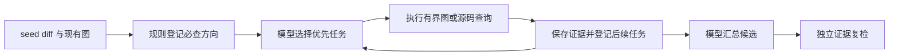

# 已有关系组合与模型遍历实验

本轮以原新 20 例为初始验证集，覆盖 10 个仓库、101 个影响标签。基线代码已推送为 182f133，沿用该组静态候选和源码图。每例三次，模型为 deepseek-v4.1-flash-1017，温度 0，关闭思考模式。

## 📊 指标对照

逐提交计算集合精确率、召回率和 F1，各指标取三次中位数，再取提交宏平均。FQN 严格匹配，CE 按类和实体名匹配。实体命中为每例三次计数中位数之和。[^paper]

| 方法 | FQN 精确率 / 召回率 / F1 | CE 精确率 / 召回率 / F1 | FQN 命中 / 标签 | 候选数 |
| --- | --- | --- | ---: | ---: |
| 独立计划 MA 基线 | 13.51% / 48.31% / 18.77% | 14.88% / 49.94% / 20.36% | 45/101 | 496 |
| 规则任务＋模型优先级 | 11.89% / 51.48% / 17.74% | 13.03% / 53.10% / 19.37% | 47/101 | 519 |
| 基线仅确认 | 24.17% / 18.98% / 18.02% | 25.42% / 20.56% / 19.86% | 13/101 | 40 |
| 新遍历仅确认 | 19.67% / 25.31% / 19.13% | 22.67% / 26.81% / 21.59% | 16/101 | 75 |

## 🔍 遍历调度

逐重复回放基线中完全相同的 Planner 输出，以固定计划内容。规则为每个 seed 登记必查方向，包括方法调用方、已存在的出向调用和字段访问。字段 seed 登记读者和写者。diff 中已有字段的新写入登记读取方，新读取登记初始化或写入方。返回实体后生成读源码、读者／写者、getter 调用方等后续任务。模型按具体影响假设选择任务及优先级，程序执行查询并记录证据。



探索最多 12 次，复检最多 6 次，合计 18 次。图路径最多三条边，失败查询和翻页占预算。导航最多 12 个模型轮次，加上 Planner、汇总和 Review 的纠错轮次，总上限 18。有未完成必查方向时拒绝提前结束，有可用后续证据时至少执行一次续查。可选任务可由模型说明理由后关闭，提前结束和预算未覆盖均留审计记录。

本轮同时改变规则生成任务、模型选择顺序和任务执行约束，还不能单独量化规则贡献与模型排序贡献。

| 方法 | 保住静态命中 | 静态之外稳定命中 |
| --- | ---: | ---: |
| 独立计划 MA 基线 | 39/39 | 6 |
| 规则任务＋模型优先级 | 39/39 | 8 |

60 次运行共执行探索查询 659 次，复检 346 次。总查询中位数 17.5。探索预算耗尽 31 次，必查方向未完成 0 次。

## 💰 Token 用量

按 API usage 统计输入和输出，计入回放的 Planner 以比较完整流程的逻辑用量。Planner 实际没有再次请求服务。异常重试未返回 usage 的消耗无法计入，费用未按缓存费率折算。

| 方法 | 输入 token 总数 | 输出 token 总数 | 总 token | 每次总 token 中位数 | 模型轮次中位数 |
| --- | ---: | ---: | ---: | ---: | ---: |
| 独立计划 MA 基线 | 1,346,319 | 110,108 | 1,456,427 | 23,596 | 4 |
| 规则任务＋模型优先级 | 6,760,696 | 162,398 | 6,923,094 | 102,816 | 9 |

## 📋 逐例结果

预测格按每次运行的 FQN 命中数 / 输出数排列。任务列为三次必查未完成数。

| 案例 | 标签 | 基线三次 | 新遍历三次 | 基线确认 | 新遍历确认 | 查询三次 | 必查未完成 |
| --- | ---: | --- | --- | --- | --- | --- | --- |
| 040 | 9 | 6/49, 7/54, 8/51 | 7/50, 7/54, 7/50 | 1/4, 0/0, 3/6 | 1/6, 1/2, 1/6 | 17, 18, 18 | 0, 0, 0 |
| 064 | 7 | 1/6, 1/4, 1/4 | 1/4, 1/4, 1/4 | 0/0, 1/4, 1/3 | 1/3, 1/3, 1/2 | 16, 13, 14 | 0, 0, 0 |
| 068 | 1 | 1/3, 1/4, 1/4 | 1/3, 1/6, 1/6 | 1/2, 1/2, 1/1 | 0/0, 1/4, 1/3 | 13, 17, 17 | 0, 0, 0 |
| 086 | 2 | 2/5, 0/1, 2/5 | 2/6, 2/6, 2/7 | 2/3, 0/0, 2/4 | 2/3, 2/2, 2/4 | 17, 16, 16 | 0, 0, 0 |
| 095 | 1 | 0/8, 0/8, 0/10 | 0/10, 0/9, 0/9 | 0/3, 0/1, 0/4 | 0/3, 0/6, 0/4 | 16, 16, 16 | 0, 0, 0 |
| 128 | 10 | 2/20, 2/22, 2/22 | 2/20, 2/19, 2/20 | 0/0, 0/0, 0/0 | 0/5, 0/0, 0/6 | 18, 18, 18 | 0, 0, 0 |
| 142 | 2 | 2/9, 2/11, 2/10 | 2/9, 2/9, 2/9 | 2/6, 1/1, 1/3 | 1/5, 1/4, 1/6 | 13, 18, 18 | 0, 0, 0 |
| 148 | 3 | 2/29, 2/22, 2/22 | 2/30, 2/23, 2/23 | 0/3, 0/1, 0/1 | 0/6, 0/1, 0/0 | 18, 18, 15 | 0, 0, 0 |
| 160 | 4 | 1/4, 3/6, 1/4 | 2/12, 2/7, 2/13 | 0/0, 0/2, 0/1 | 1/3, 1/4, 1/3 | 18, 17, 18 | 0, 0, 0 |
| 218 | 3 | 1/88, 1/87, 2/88 | 2/92, 2/93, 2/87 | 0/2, 0/0, 1/4 | 1/5, 1/5, 1/5 | 18, 18, 16 | 0, 0, 0 |
| 058 | 2 | 2/21, 2/17, 2/22 | 2/19, 2/19, 2/23 | 0/2, 0/0, 0/6 | 2/5, 2/6, 2/4 | 18, 15, 17 | 0, 0, 0 |
| 065 | 8 | 6/32, 6/32, 6/32 | 6/32, 6/33, 6/32 | 1/1, 1/4, 1/1 | 2/5, 1/4, 0/3 | 16, 16, 17 | 0, 0, 0 |
| 079 | 6 | 0/40, 0/39, 0/40 | 0/41, 0/40, 0/39 | 0/0, 0/1, 0/1 | 0/2, 0/3, 0/3 | 15, 18, 15 | 0, 0, 0 |
| 112 | 6 | 0/22, 0/24, 0/24 | 0/24, 0/24, 0/24 | 0/1, 0/4, 0/4 | 0/5, 0/3, 0/4 | 18, 18, 18 | 0, 0, 0 |
| 101 | 4 | 0/5, 1/2, 0/1 | 1/11, 1/9, 0/1 | 0/2, 1/1, 0/0 | 0/4, 1/3, 0/0 | 17, 18, 6 | 0, 0, 0 |
| 132 | 2 | 0/14, 0/14, 0/14 | 0/14, 0/14, 0/14 | 0/0, 0/1, 0/2 | 0/2, 0/5, 0/4 | 15, 18, 17 | 0, 0, 0 |
| 156 | 3 | 3/46, 3/46, 3/46 | 3/46, 3/46, 3/46 | 1/2, 1/2, 1/2 | 3/5, 0/2, 1/3 | 18, 18, 18 | 0, 0, 0 |
| 262 | 8 | 7/20, 7/18, 7/18 | 7/21, 7/19, 7/20 | 1/4, 2/3, 2/2 | 0/0, 1/2, 0/0 | 18, 18, 18 | 0, 0, 0 |
| 206 | 5 | 0/4, 1/5, 1/5 | 0/9, 0/6, 2/8 | 0/0, 1/1, 1/3 | 0/5, 0/5, 2/5 | 17, 18, 18 | 0, 0, 0 |
| 090 | 15 | 7/77, 7/76, 7/76 | 8/77, 7/76, 7/76 | 2/5, 2/2, 1/2 | 4/6, 5/6, 4/5 | 18, 18, 17 | 0, 0, 0 |

## 🧪 标签变化

| 案例 | 标签 FQN | 基线次数 | 新遍历次数 |
| --- | --- | ---: | ---: |
| 040 | `org.apache.commons.compress.compressors.bzip2.BZip2CompressorInputStream.createHuffmanDecodingTables(int,int)` | 2/3 | 3/3 |
| 040 | `org.apache.commons.compress.compressors.bzip2.BZip2CompressorInputStream.hbCreateDecodeTables(int[],int[],int[],char[],int,int,int)` | 1/3 | 0/3 |
| 086 | `org.apache.gora.accumulo.store.AccumuloStore.putArray(org.apache.accumulo.core.data.Mutation,int,java.lang.Object,org.apache.accumulo.core.util.Pair)` | 2/3 | 3/3 |
| 086 | `org.apache.gora.accumulo.store.AccumuloStore.putMap(org.apache.accumulo.core.data.Mutation,int,org.apache.avro.Schema,java.lang.Object,org.apache.accumulo.core.util.Pair)` | 2/3 | 3/3 |
| 160 | `org.apache.commons.beanutils.MethodUtils.invokeExactMethod(java.lang.Object,java.lang.String,java.lang.Object)` | 0/3 | 3/3 |
| 160 | `org.apache.commons.beanutils.MethodUtils.invokeExactStaticMethod(java.lang.Class,java.lang.String,java.lang.Object)` | 1/3 | 0/3 |
| 160 | `org.apache.commons.beanutils.MethodUtils.invokeStaticMethod(java.lang.Class,java.lang.String,java.lang.Object)` | 1/3 | 0/3 |
| 218 | `org.apache.bcel.generic.ReferenceType.isCastableTo(org.apache.bcel.generic.Type)` | 1/3 | 3/3 |
| 101 | `org.apache.giraph.edge.MutableEdgesWrapper.size()` | 1/3 | 2/3 |
| 206 | `org.apache.commons.beanutils.ResultSetIterator.get(java.lang.String)` | 0/3 | 1/3 |
| 206 | `org.apache.commons.beanutils.RowSetDynaClass.copy(java.sql.ResultSet)` | 2/3 | 1/3 |
| 090 | `org.apache.commons.compress.compressors.lzma.LZMACompressorInputStream.LZMACompressorInputStream(java.io.InputStream)` | 0/3 | 1/3 |

## 📝 结果解读

本轮 FQN 宏召回提高 3.17 个百分点。逐提交召回提高 3 例，下降 1 例，其余持平。静态之外稳定命中从 6 个增至 8 个，总 token 为基线的 4.75 倍。候选精确率和 F1 下降，确认集的召回和 F1 提高。

60 次均完成了登记的必查方向并至少执行一次后续证据查询。本轮探索共包含 315 次图边展开、203 次声明读取和 141 次源码搜索。模型可以在预算用尽前终止，仍有可选任务未查完；任务队列同时记录预算延期和提前结束的未解线索。原来的提前提交现象得到约束，但多轮对话反复携带任务列表、源码和路径证据，输入 token 明显增加。这些案例已用于诊断和本次验证，后续泛化结论需要独立数据。

```bash
python src/run_full_fields.py --experiment rule-traversal-new20 --variant ma --ma-workflow rules --env-file ../work/ripple/.env.ripple100
python src/report_rule_traversal.py
```

[^paper]: katIA §V-A, https://arxiv.org/html/2611.10958v1#S5.SS1
