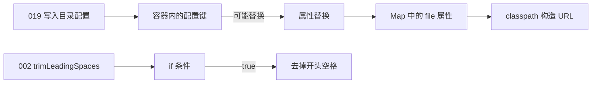

# 配置、值传递与条件关系的静态细图

此版本在原方法级关系图旁增加语句和表达式层，按 seed 所在类及两跳调用涉及的类建立局部细图，再把可达证据投影成方法或字段候选。只使用 parent 源码和给定 seed diff。

## 🔍 已实现的关系

| 关系 | 表达的内容 | 证据与限制 |
| --- | --- | --- |
| CONFIG_KEY／CONFIG_WRITE／CONFIG_READ | 配置键、配置读写调用与值 | 容器身份和键共同作为配置项 ID。支持 Properties、System 属性；项目 setVariable/getVariable 或 setProperty/getProperty 成对接口采用显式约定模型。模型推断有独立标记。 |
| VALUE_FLOW／ARGUMENT／RETURN_VALUE | 局部赋值、参数绑定、返回及表达式传递 | 局部覆盖替换旧定义，条件分支保守合流；调用按位置实例化独立参数，最多内联三层。 |
| SUBSTITUTES／CONTAINER_WRITE／CONTAINER_READ | 模板替换后的值，经 Map 传给下游 | 已知模板只连接明确的键；动态模板以及动态 Map 键按同容器的可能匹配连接，certainty 为 may。 |
| READ_VALUE／WRITE_VALUE | 字段与具体读写表达式 | 字段存储为保守的流不敏感模型，实例别名仍可能合并。 |
| CONDITION_INPUT／GUARDS | 值进入条件，以及条件 true/false 或循环体中的调用、赋值、返回、异常 | 记录语法嵌套控制，覆盖 if、循环及三元表达式。该关系未包括完整 CFG 的控制依赖和异常路径可行性分析。 |

每个源码节点包含方法 FQN、文件、行号、代码片段、调用上下文和版本。每条边带关系类型和确定性标记。条件中的普通字段和算法阈值保留为字段。泛化的 Map 值传播与配置项分类使用不同节点类型。

## 🧭 两条验证路径



019 的动态 XML 属性无法静态确定引用了哪个配置键，所以替换和动态键匹配是可能依赖。同一方法也可能在多个抽象调用上下文出现，候选按原 FQN 去重。

## 🧪 定向检查

已执行 23 项测试，包含不同容器同名键隔离、同容器不同键隔离、局部覆盖、跨方法参数和返回、配置包装方法、模板替换、Map 传播、分支及循环方向、diff 新字段读取和源码行映射、节点预算。002 实例验证了 trimLeadingSpaces 对 replaceFirst 的 true 分支控制，019 实例验证了ivy.settings.dir 经替换和属性容器到 classpath URL 构造的可能路径。

| 案例 | 原静态命中／候选 | 加细图后命中／候选 | 细图节点／边 |
| --- | ---: | ---: | ---: |
| 002 | 3/39 | 3/44 | 1980/3079 |
| 013 | 1/11 | 1/20 | 4229/7224 |
| 017 | 1/22 | 1/25 | 8179/10715 |
| 019 | 0/24 | 1/160 | 24640/37288 |

019 补回目标，但配置替换的保守传播扩大了候选。此表只检查关系能否表示并被检索，完整召回、精确率和泛化效果需要后续独立评估。

## ⚙️ 使用方式

```bash
python src/static_compare.py --config-control --rows 2,13,17,19
```

输出候选组为 config_control，结果写入 results/static-config-control。原组合字段候选组仍单列，可以核对新增关系带来的变化。完整细图单独缓存在 dataset/indexes，结果包含缓存指纹、未解析项、候选证据路径和路径用到的节点。

仓库查询接口支持 fine_neighbors，可用 indexed FQN 或细图节点 ID，按方向、关系类型查询，每页最多 20 条边。使用该接口会按需构建并缓存细图。

```python
repo.query({"tool": "fine_neighbors", "fqn": seed_fqn, "direction": "out", "kind": "CONDITION_INPUT"})
```

未知调用用 OPAQUE_TRANSFORM 保守连接参数及接收者，动态配置键登记为未解析。细图节点上限 100000，调用展开上限三层，候选证据路径上限 40 条细边。达到限制时输出 truncated 标志。当前 SP／MA 实验默认仍使用 combined_field_paths；本轮实现的是静态层及可查询接口。
